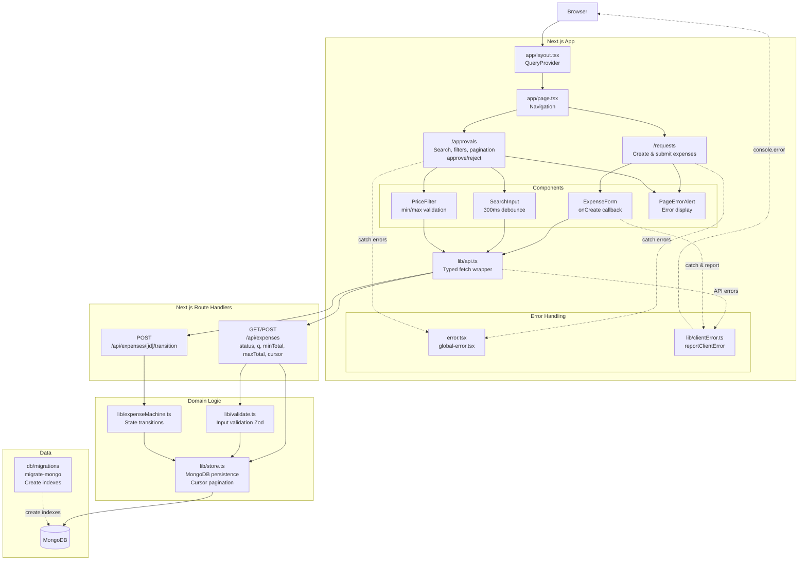
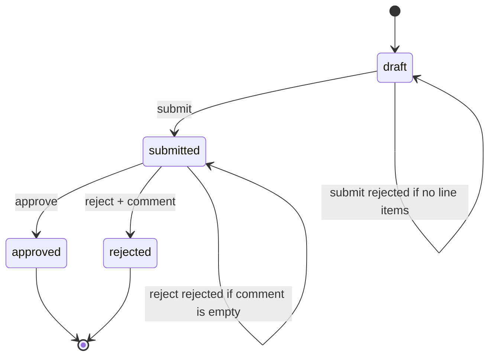

# Expense Approval Workflow

An expense approval workflow with state machine validation in a Next.js application.


## Features

### Expense requests
Users create expense requests with a title and one or more line items (description + amount). The server computes the total from the line items.

### Status transitions 
Expenses follow this lifecycle: `draft` → `submitted` → `approved` or `rejected`. Invalid transitions should be rejected. Rejection requires a comment.

### Pages
User Requests (`/requests`) for viewing and creating expenses
Approval Queue (`/approvals`) for acting on submitted expenses.

### Search and filters
Both pages list expenses through `GET /api/expenses`, which supports:

- `status`: filter by lifecycle status (the approval queue uses `submitted`).
- `q`: case-insensitive substring search over the title and line item descriptions. It is a regex scan
  (the query is escaped and capped at 100 characters), so partial words like "Sev" match "Sevilla trip".
- `minTotal` / `maxTotal`: inclusive price bounds. The price fields only accept digits and one decimal
  point; invalid or inverted ranges are rejected with a 400.
- `cursor`: cursor-based pagination (newest first). Responses are `{ items, nextCursor? }`, and the
  approval queue has previous/next controls. Search input is debounced by 300ms and in-flight requests are
  aborted.

## Quick Start

### Prerequisites
- Node.js >= 26.0
- npm 11.x
- MongoDB (local or Docker)

### Installation

```bash
# Install dependencies
npm install

# Start MongoDB with Docker
docker compose up -d mongo

# Apply database migrations
npm run db:migrate

# Start the development server
npm run dev
```

The app will be available at `http://localhost:3000`.

## Running Commands

### Development
```bash
npm run dev      # Start Next.js dev server (port 3000)
npm run build    # Build for production
npm start        # Start production server
```

### Testing
```bash
npm test                # Run unit tests (lib/*.test.ts)
npm run test:components # Run component tests with Vitest + Testing Library
npm run test:e2e        # Run Playwright e2e tests (requires `npm run dev` on port 3100)
```

### Database
```bash
npm run db:migrate        # Apply pending migrations
npm run db:migrate:status # Check migration status
npm run db:migrate:down   # Rollback last migration
npm run db:migrate:create # Create a new migration
```

## Architecture and workflow

The Next.js pages call route handlers through the shared API client. The route
handlers delegate validation and state transitions to the domain logic, which
persists expenses in MongoDB. Transitions are written only if the stored status
still matches the status that was validated, preventing concurrent requests
from applying conflicting actions.



Expense lifecycle:



Expenses are persisted in MongoDB. Indexes (pagination on `createdAt`/`_id` and
`status`/`createdAt`/`_id`) are defined only in `migrate-mongo` migrations under `db/migrations/`.
Docker Compose runs them through a one-shot `migrate` service that the app waits for, and sample
expenses are seeded when MongoDB initializes (`docker/mongo-seed.js`).

## Docker

Run the entire stack (app + MongoDB) with:

```bash
docker compose up --build
```

The app will be available at `http://localhost:3000`. MongoDB data is persisted in the `mongo-data` Docker volume. Migrations run automatically on startup through the `migrate` service.

## Environment Variables

Set these in a `.env.local` file for local development:

```bash
MONGODB_URI=mongodb://localhost:27017
MONGODB_DB=expense_approval
NODE_ENV=development
```

For production deployments, set `MONGODB_URI` and `MONGODB_DB` to point to your MongoDB instance.

## Project Structure

- **`app/`** — Next.js App Router pages and API routes
  - `requests/` — User expense requests page
  - `approvals/` — Approval queue page
  - `api/expenses/` — REST API endpoints
- **`components/`** — React components (shadcn/ui)
- **`lib/`** — Domain logic
  - `expenseMachine.ts` — State machine for expense transitions
  - `store.ts` — MongoDB persistence layer
  - `validate.ts` — Input validation (Zod)
  - `api.ts` — Typed fetch client
  - `clientError.ts` — Error handling and reporting
  - `types.ts` — TypeScript type definitions
- **`db/migrations/`** — Database migrations (migrate-mongo)
- **`e2e/`** — Playwright end-to-end tests
- **`tests/`** — Component test utilities

## Tech stack

[](https://nodejs.org/) [](https://www.npmjs.com/) [](https://nextjs.org/) [](https://react.dev/) [](https://www.typescriptlang.org/) [](https://tailwindcss.com/) [](https://www.mongodb.com/) [](https://playwright.dev/)