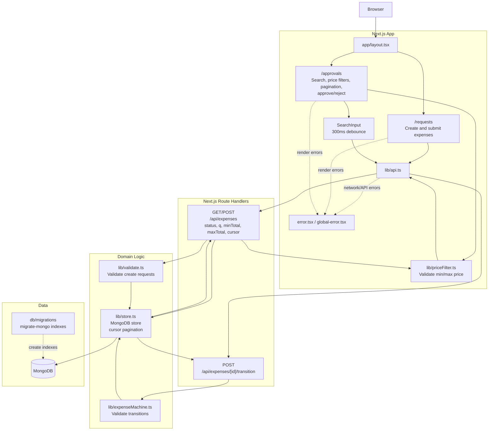
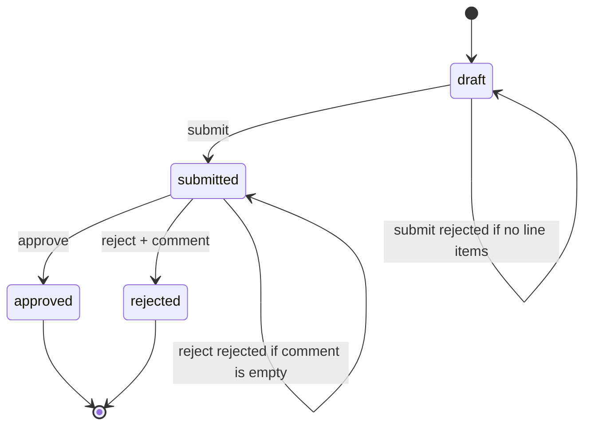

# Expense Approval Workflow

Build a expense approval workflow with state machine validation in a Next.js application. The starter project includes types, minimal seed data, a search component, and page shells with navigation.

## Feature

### Expense requests
Users create expense requests with a title and one or more line items (description + amount). The server computes the total from the line items.

### Status transitions 
Expenses follow this lifecycle: `draft` → `submitted` → `approved` or `rejected`. Invalid transitions should be rejected. Rejection requires a comment.

### Pages
User Requests (`/requests`) for viewing and creating expenses
Approval Queue (`/approvals`) for acting on submitted expenses.

### Search and filters
Both pages list expenses through `GET /api/expenses`, which supports:

- `status`: filter by lifecycle status (the approval queue uses `submitted`).
- `q`: case-insensitive substring search over the title and line item descriptions. It is a regex scan
  (the query is escaped and capped at 100 characters), so partial words like "Sev" match "Sevilla trip".
- `minTotal` / `maxTotal`: inclusive price bounds. The price fields only accept digits and one decimal
  point; invalid or inverted ranges are rejected with a 400.
- `cursor`: cursor-based pagination (newest first). Responses are `{ items, nextCursor? }`, and the
  approval queue has previous/next controls. Search input is debounced by 300ms and in-flight requests are
  aborted.

### UI polish
Loading indicators, empty states, and error handling for failed API calls.

## Architecture and workflow

The Next.js pages call route handlers through the shared API client. The route
handlers delegate validation and state transitions to the domain logic, which
persists expenses in MongoDB. Transitions are written only if the stored status
still matches the status that was validated, preventing concurrent requests
from applying conflicting actions.



Expense lifecycle:



Expenses are persisted in MongoDB. Indexes (pagination on `createdAt`/`_id` and
`status`/`createdAt`/`_id`) are defined only in `migrate-mongo` migrations under `db/migrations/`.
Docker Compose runs them through a one-shot `migrate` service that the app waits for, and sample
expenses are seeded when MongoDB initializes (`docker/mongo-seed.js`).

## Docker

Run the app and MongoDB together with:

```bash
docker compose up --build
```

The app is available at `http://localhost:3000`. MongoDB data is stored in the
`mongo-data` Docker volume.

## Local development

```bash
docker compose up -d mongo   # MongoDB on 127.0.0.1:27017
npm run db:migrate           # apply pending migrations
npm run dev
```

Other migration commands: `db:migrate:status`, `db:migrate:down`, `db:migrate:create <name>`. Set
`MONGODB_URI` / `MONGODB_DB` to point at a different database. Run migrations before deploying code that
depends on them.

## Tests

- `npm test`: unit tests for `lib/*.test.ts` (`lib/store.test.ts` needs MongoDB and uses a throwaway database).
- `npm run test:components`: Vitest + Testing Library tests for the pages, with `@/lib/api` mocked.
- `npm run test:e2e`: Playwright tests against a real `next dev` (port 3100) and the
  `expense_approval_e2e` database. First time: `npx playwright install chromium`.
