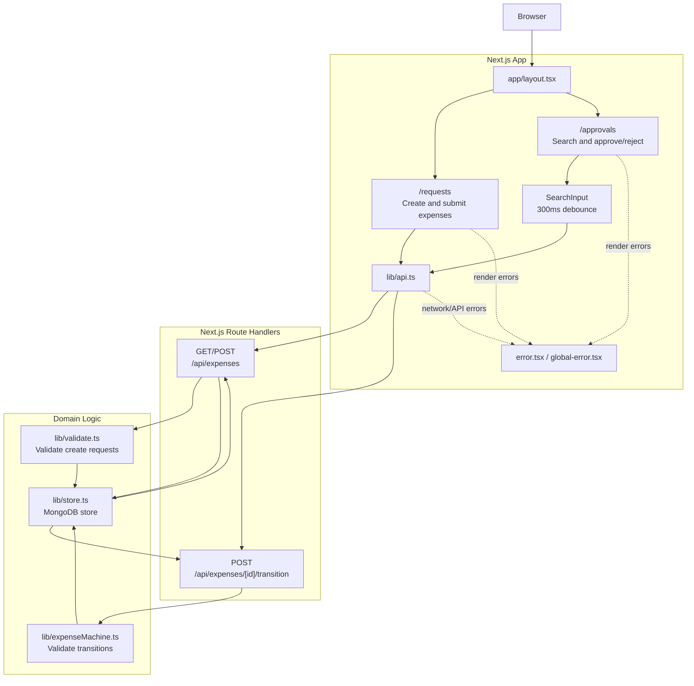
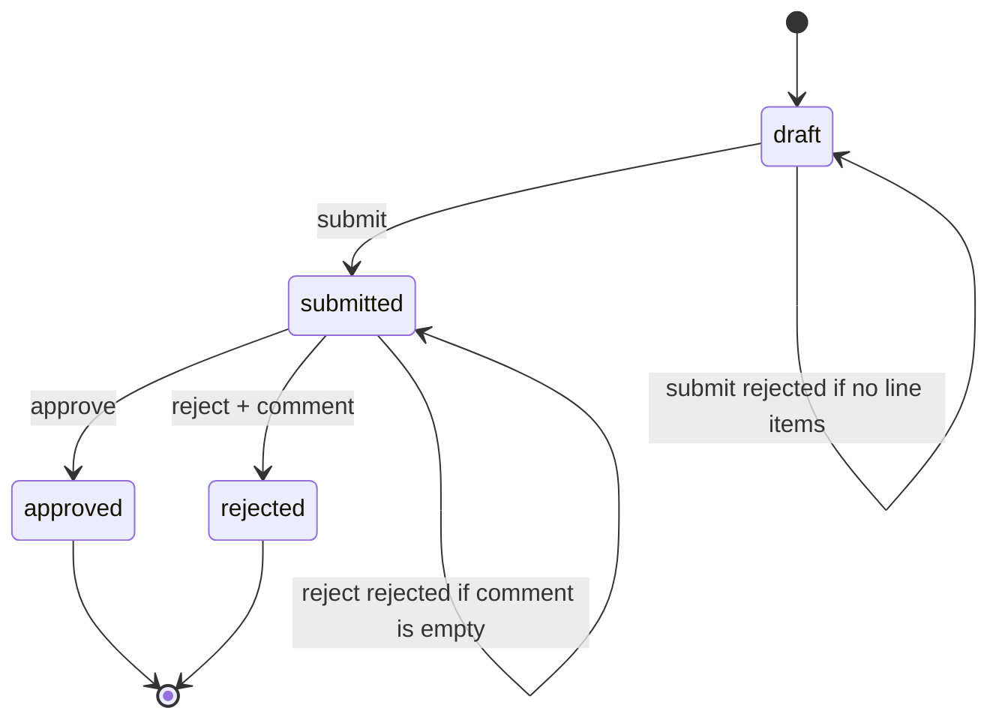

# Expense Approval Workflow

Build a expense approval workflow with state machine validation in a Next.js application. Build an expense approval workflow in a Next.js application. The starter project includes types, minimal seed data, a search component, and page shells with navigation.

## Feature

### Expense requests
Users create expense requests with a title and one or more line items (description + amount). The server computes the total from the line items.

### Status transitions 
Expenses follow this lifecycle: `draft` → `submitted` → `approved` or `rejected`. Invalid transitions should be rejected. Rejection requires a comment.

### Pages
User Requests (`/requests`) for viewing and creating expenses
Approval Queue (`/approvals`) for acting on submitted expenses.

### Search component
The approval queue page has a search component that requires attention.

### UI polish
Loading indicators, empty states, and error handling for failed API calls.

## Architecture and workflow

The Next.js pages call route handlers through the shared API client. The route
handlers delegate validation and state transitions to the domain logic, which
currently stores expenses in memory.



Expense lifecycle:



Expenses are persisted in MongoDB. The Docker Compose setup creates the indexes
and sample expenses when MongoDB initializes.

## Docker

Run the app and MongoDB together with:

```bash
docker compose up --build
```

The app is available at `http://localhost:3000`. MongoDB data is stored in the
`mongo-data` Docker volume.
